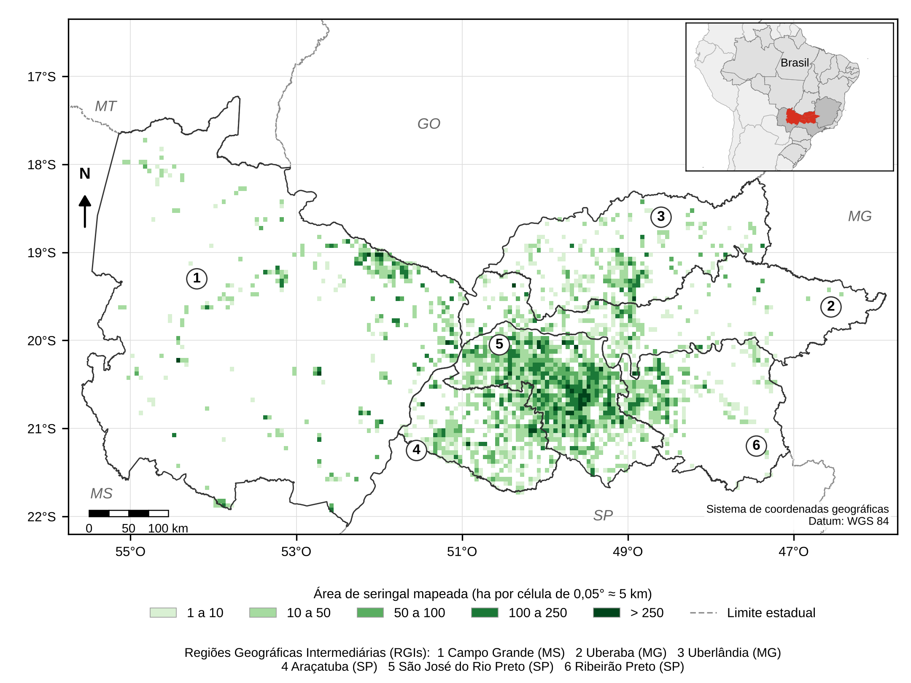

# Detecção automática de seringais com Sentinel-2 no Google Earth Engine

Scripts e dados do Trabalho de Conclusão de Curso (Agronomia, IFSP Barretos, 2026)
de **Guilherme Araújo de Oliveira**, orientado pelo Prof. Dr. Eduardo Pinheiro de Freitas.

O método identifica seringais (*Hevea brasiliensis*) pela fenologia: a desfolha no inverno
e a rebrota rápida, medidas pelo NDVI de imagens Sentinel-2 (Cloud Score+, decêndios),
em seis Regiões Geográficas Intermediárias (RGIs) de SP, MG e MS.

## Regras do mapa de 2025 (20 m)

| Regra | Métrica | Limiar |
|---|---|---|
| R1 | Amplitude do NDVI (máx. pós-rebrota − mín. na seca) | ≥ 0,25 |
| R2 | NDVI máximo pós-rebrota | ≥ 0,85 |
| R3 | NDVI na chuva (percentil 10, jan–abr) | ≥ 0,60 |
| Máscara | MapBiomas Coleção 11, classe 3 (formação florestal) | removida |

Pós-processamento: suavização 3×3, fechamento morfológico (20 m) e área mínima de 5 ha.

## Ordem de execução (Code Editor do GEE)

| # | Script | Apêndice | O que faz |
|---|---|---|---|
| 1 | `assinatura_espectral_v3_1.js` | A | assinatura espectro-temporal dos pontos de calibração |
| 2 | `deteccao_v2_2_etapaA_metricas.js` | B | Etapa A: calcula e salva as métricas (assets de 20 m) |
| 3 | `deteccao_v2_3_etapaB_mapa.js` | C | Etapa B: aplica regras + máscara e gera o mapa |
| 4 | `validacao_sorteio_v2.js` | D | sorteio estratificado dos 200 pontos de validação |
| 5 | `validacao_gabarito_v1.js` | – | cruza os rótulos da interpretação com o mapa |
| 6 | `metricas_pontos_validacao.js` | – | extrai as métricas em cada ponto de validação |
| 7 | `validacao_mapbiomas_v1.js` | E | teste da máscara do MapBiomas (pontos e áreas) |
| – | `exportar_pontos_calibracao.js` | – | exporta as coordenadas dos pontos de calibração |

## Antes de rodar

1. **Imports**: os scripts usam variáveis importadas no Code Editor, que não aparecem no código:
   `rgi_cg, rgi_uba, rgi_udi, rgi_ara, rgi_sjp, rgi_rp` (limites das Regiões Geográficas Intermediárias, IBGE 2017) e, no script 1,
   `grupo_1`…`grupo_4`, `pivo, cana, pasto, eucalipto, mata` (pontos de calibração).
   Suba esses arquivos como *Assets* (tabelas) e importe-os com esses nomes.
2. **Pasta de assets**: troque `PASTA_ASSET` pela sua pasta (`projects/SEU-PROJETO/assets/`).
3. Rode a Etapa A (tarefas na aba *Tasks*) e só depois a Etapa B.

## Dados

Ver [`dados/LEIA-ME.md`](dados/LEIA-ME.md): pontos e métricas da calibração, pontos rotulados da validação e resultados do teste com o MapBiomas.

## Licenças

- Código: MIT (ver `LICENSE`).
- Dados e figuras deste repositório: CC BY 4.0.
- Dados de terceiros: Sentinel-2 (Copernicus/ESA, uso livre), Cloud Score+ (Google),
  MapBiomas (CC BY 4.0) e limites do IBGE — citar as fontes originais.

## Como citar

OLIVEIRA, G. A. **Detecção automática de seringais (*Hevea brasiliensis*) por meio de assinatura espectro-temporal**: validação de algoritmo via imagens do sensor Sentinel-2/MSI no Google Earth Engine. 2026. Trabalho de Conclusão de Curso (Bacharelado em Agronomia) –
Instituto Federal de São Paulo, Barretos, 2026. Código disponível em: https://github.com/guilherme-oliveira-agro/seringais-sentinel2-gee.
